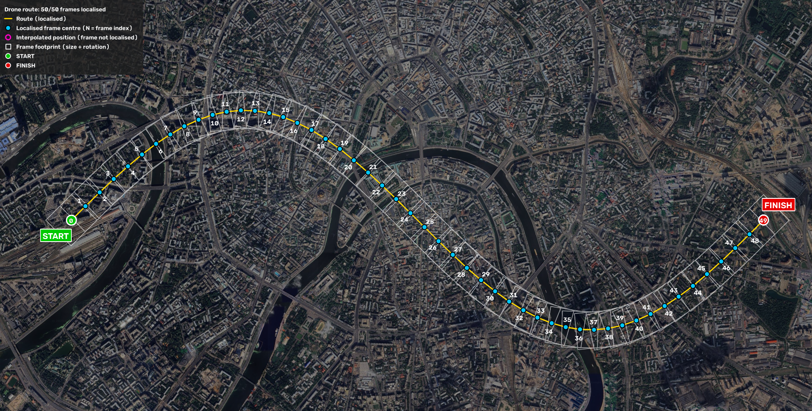

# Drone Navigation — route reconstruction from aerial frames (classic CV)

Test assignment for It-Jim, *Classic CV — Drone navigation*, standard level.

## Task

We have a satellite panorama of an area (`global_map.png`, 3645×1845) and 50 consecutive
"drone photos" (`crop_0.png … crop_49.png`, 640×640). Each photo is a rotated, zoomed-in
fragment of the same map. The goal is to find where every frame lies on the map, then reconstruct
and visualise the flight route. This simulates GPS-free (jamming-resistant) visual navigation.

The solution uses classic computer vision only (SIFT + OpenCV), no neural networks.

## Approach

```
map ──► SIFT (full resolution, all keypoints) ──► FLANN KD-tree index   (built once)
frame ─► ×0.25 resize ─► gray ─► SIFT ─► FLANN kNN (k=2) ─► Lowe ratio 0.75
      ─► estimateAffinePartial2D + RANSAC ─► 2×3 similarity frame→map
      ─► centre + 4 corners on the map ─► sanity checks (inliers, scale)
all frames ─► linear interpolation of failed frames ─► optional Savitzky–Golay ─► route.png / CSV / video
```

**Why SIFT.** Frames are rotated by arbitrary angles (45°…135° in this data) and are ~4× more
detailed than the map. SIFT is invariant to rotation and scale, it is in mainline OpenCV, and
on this data it gives hundreds of correct matches per frame. Binary descriptors such as ORB
are faster but less reliable across a 4× change in scale.

**Why a similarity transform, not a homography.** The frames are plain crops of the map: shift +
rotation + uniform scale, with no perspective. On identical matches, `findHomography` produced
perspective coefficients around 1e-6 and the same reprojection error (0.15–0.20 px) as
`estimateAffinePartial2D`. A homography has 8 degrees of freedom instead of 4, so it gains
nothing here and can return a skewed footprint. A similarity transform is also easy to
interpret: its rotation is the drone's heading and its scale is a built-in plausibility check.

**Why frames are downscaled 4×, but the map is not.** The frame-to-map scale is a constant
0.253, so a frame shrunk ×0.25 has roughly the map's own resolution. At that scale ~99% of the
ratio-test matches become RANSAC inliers, compared with 80–85% at full size. The absolute number
of inliers stays about the same, centre accuracy is unchanged (≤ 1 px difference), and a
160×160 frame is processed much faster. The matrix is still expressed in *original* frame
pixels: keypoint coordinates are divided by 0.25 before estimation.

**Why the number of map keypoints is not capped.** With `nfeatures=40000`, some map regions were
left almost featureless, and frame 49 dropped to ~20 inliers. Uncapped (~152k keypoints, ~6 s
once at start-up), the same frame gets 211 inliers.

**Robustness.** A frame counts as localised only if it has at least `min_inliers` (20) RANSAC
inliers and a scale within ±15% of the expected 0.253. Failed frames are not dropped. They are
marked `interpolated` in the CSV, their positions are linearly interpolated, and they are drawn
differently on the map.

**Smoothing.** The route is already smooth, so Savitzky–Golay smoothing (window 5, order 2) is
optional and turned off with `--no-smooth`. The CSV keeps the raw measured centre (`x_raw`,
`y_raw`) next to the final track (`x`, `y`).

All parameters live in [`drone_nav/config.py`](drone_nav/config.py). The default values come
from a preliminary data study whose findings are summarised above.

## Project layout

```
main.py                 CLI entry point
drone_nav/
  config.py             all parameters (dataclass)
  io_utils.py           image reading, numeric frame ordering (crop_2 before crop_10)
  features.py           SIFT, resize, FLANN, ratio test
  localizer.py          MapLocalizer: map features once, localize(frame) -> FramePose
  trajectory.py         NaN interpolation, Savitzky–Golay smoothing
  visualize.py          route.png and the optional fly-over video
tests/                  pytest suite on synthetic images (no real data needed)
tools/check_reference.py  dev check: compares trajectory.csv with a local reference table
```

## How to run

Python 3.10+.

```bash
python -m venv .venv
# Windows: .venv\Scripts\activate    Linux/macOS: source .venv/bin/activate
pip install -r requirements.txt
```

Put the task data into `data/` (see [`data/README.md`](data/README.md)), then:

```bash
python main.py --map data/global_map.png --frames data/crops --out outputs
python main.py --map data/global_map.png --frames data/crops --out outputs --video   # + flyover.mp4
python main.py ... --no-smooth                                                       # raw track
python main.py ... --no-show                                                         # do not open the route window
```

At the end of a run the route opens in a window (press any key to close it). If there is no
display, the window is skipped and the files are still saved.

Outputs:

| File | Content |
|---|---|
| `outputs/route.png` | map with route line, numbered points, START / FINISH, rotated frame footprints, legend |
| `outputs/trajectory.csv` | `index, x, y, angle_deg, scale, n_matches, n_inliers, status, frame, x_raw, y_raw` |
| `outputs/flyover.mp4` | (with `--video`) zoomed chase view, route so far, current footprint, drone-frame inset |

Tests and reference check:

```bash
pytest
python tools/check_reference.py    # only if you have a local reference table (research.md)
```

The tests generate a random textured "map", cut out rotated and zoomed frames with known
parameters, and check that the localizer recovers centre, angle, scale and corners. They also
cover numeric frame ordering, interpolation, smoothing and an end-to-end CLI run.

## Results

Run on the task data (3645×1845 map, 50 frames of 640×640):

| Metric | Value |
|---|---|
| Localised frames | 50 / 50 (none interpolated) |
| RANSAC inliers per frame | min 104, median 261 (threshold: 20) |
| Frame→map scale | 0.2534–0.2537 (expected 0.253) |
| Heading (rotation) | 45.2° … 134.9° |
| Step between consecutive frames | 63–90 px, median 78 px, no jumps |
| Time | map features 1.7 s, 29 ms/frame, ~4 s total (CPU) |

The route goes smoothly from START (frame 0, left) to FINISH (frame 49, right), and the
rotated footprints follow the road.



*`docs/route.png` is a 2× downscaled copy of `outputs/route.png`.*

There is no ground-truth table for this data, so accuracy was judged by internal consistency
(constant scale, uniform steps, overlay on the map), not against reference coordinates.

## Limitations

- The global search over the whole map assumes the map is roughly the same imagery as the
  frames (same season, lighting and sensor). Real drone footage taken months later would need
  more robust matching.
- The similarity model assumes a nadir (straight-down) camera. Oblique views or terrain relief
  break it.
- Interpolation fills short gaps well. Long gaps on a curved path are approximated by straight
  segments.
- Map features are recomputed on every run (~6 s). They could be cached to disk for repeated runs.

## Ideas for the advanced level

- **Screen-recorded video at an angle:** switch to `findHomography` (real perspective), add CLAHE
  to deal with screen glare and contrast, and filter out frames with motion blur.
- **Windowed search:** neighbouring frames overlap heavily (~77 px step vs ~162 px footprint).
  Matching only against map features within ~300 px of the previous position would be faster and
  would reject repetitive-texture false matches, with a fallback to global search when tracking
  is lost.
- **Motion model:** a Kalman filter over position and heading instead of post-hoc smoothing, which
  also gives a prediction for the windowed search.
- **Learned matching:** SuperPoint + LightGlue or LoFTR for strong appearance changes.
